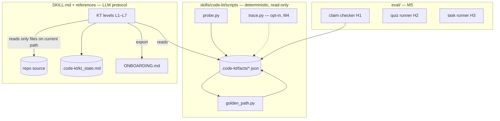

# CODE_PLAN — code-kt

Reading order: `avani_instructions.md` → this file → `CLAUDE_CODE_BRIEF.md` → `PROJECT_PLAN.md` → `SURVEY.md`.

## 1. Non-negotiables

1. **Reuse, don't build.** Every fact comes from an existing analyser (stdlib ast, ctags/tree-sitter,
   code2flow, lizard, git, networkx). Glue only. A new analysis needs a written reason.
2. **Read-only, no network, no execution** in `scripts/`. Writes only under `<repo>/.code-kt/`.
   Runtime tracing (M4) lives in a separate, opt-in script.
3. **Graceful degradation.** A missing tool → `{"skipped": reason}`; the skill still works with git + Python.
4. **Every fact carries `path:line`** and every facts set carries `provenance.json` (commit, tool versions).
5. **The LLM never invents structure.** Diagrams and claims trace to facts or to a file it read.
6. Minimal diffs, one concern per PR; behaviour-preserving refactors proven by regenerate-and-diff on `examples/`.

## 2. High-level design



## 3. Repo layout

```
code-kt/
  .claude-plugin/{plugin.json, marketplace.json}
  skills/code-kt/
    SKILL.md
    references/{kt_protocol.md, facts_schema.md}
    scripts/{probe.py, golden_path.py, trace.py (M4)}
  examples/<repo>/{facts/, golden_path.json, ONBOARDING.md (M1)}
  eval/ (M5): {claims.py, quiz/, tasks/, runners/, results/}
  tests/ (M2): golden facts for tiny fixture repos
  docs/  (this document set)
  .github/workflows/{ci.yml, onboarding-action.yml (M7)}
```

## 4. Contracts

### 4.1 Probe (refactor target, M2)
Today the probes are functions in `probe.py`. M2 turns them into a registry without changing output:

```python
class Probe(Protocol):
    name: str                    # output file stem, e.g. "calls"
    requires: list[str]          # other probe names it reads
    def available(self) -> str | None      # None = ok, else skip reason (tool missing, wrong language)
    def run(self, ctx: RepoCtx, facts: dict) -> dict   # JSON-serialisable, path:line locations
```
`RepoCtx` = repo root, file lists (`all`, `src`, `py_all`, `py_src`), primary language, `run()` helper with
timeout. Backends per language are separate Probes with the same `name` and a priority. The first
available one wins and records `backend` in its output. Adding a language must not edit other probes.

### 4.2 facts schema
`references/facts_schema.md` is the contract. Any field change bumps `schema_version` in
`provenance.json` and updates the schema doc in the same PR. CI regenerates `examples/` and fails on an
unexplained diff.

### 4.3 Call graph (Python, `ast-import-aware`)
Resolution order for `f()` / `x.f()` inside file F: (1) def of `f` in the module F imported it from,
(2) def of `f` in F, (3) the unique def of `f` in the repo; otherwise drop. Edge = `{src, dst, line}`.
Known blind spots: callbacks, DI, untyped method calls, dynamic dispatch, plugins. These are
handled by `[R]` bridging (skill) or the trace backend (M4), never by guessing in the script.

### 4.4 Golden path (`golden_path.py`)
- Start: first `console_script` target → its def. Libraries (M2): pick the test in `tests_map` that
  imports the most top-5 abstraction modules, start from the first public-API call in it.
- Outline: under each node keep the `--width` (3) unvisited callees with the largest reachable set
  (bounded BFS), tie-break hotspot rank, then core-abstraction file; list them in call-site order;
  recurse to `--depth` (4).
- Output is a reading order. The skill verifies every hop.

### 4.5 Core abstractions
`score = distinct referencing files × log2(nloc+1)`, public classes only. M2: count a reference only
if the name resolves to that class through imports (fixes the `Path` collision).

### 4.6 Trace backend (M4, opt-in)
`trace.py <repo> -- <command | pytest node id>` runs under `sys.setprofile` (or coverage.py dynamic
contexts), filtered to repo files, and records the observed caller→callee edges with call order.
Output `facts/trace.json`. `golden_path.py --prefer-trace` merges observed edges. Only runs after the
human says yes, in their own environment, never in CI on third-party repos.

### 4.7 Evaluation (M5)
- **Claim checker (H1):** extract tagged claims from transcripts / ONBOARDING.md (regex on
  `[F|R|I] ... path:line`). Auto-check: file exists, line in range, named symbol defined at/near the
  line, cited edge exists in facts or trace. Human audit of a 50-claim stratified sample per arm.
- **Quiz (H2):** `eval/quiz/<repo>.yaml`, 15 MCQ/short answers written from code by a human.
  A fresh model gets only the KT output (no repo) and answers. Exact-match / rubric grading.
- **Tasks (H3):** 5 small issues per repo with a hidden test. The agent gets the repo ± KT output.
  Log tokens, turns, pass@1.
- All results go to `eval/results/<date>/<arm>/<repo>/<seed>.json` with config hash + git commit.

## 5. Milestones → code

| M | Code work | Done when |
|---|---|---|
| M0 | scaffold, probe v0, golden_path v0, examples | ✅ click + httpie generate in < 2 s |
| M1 | protocol edits only (SKILL.md, kt_protocol.md) | two dogfood transcripts, all claims tagged |
| M2 | Probe registry refactor (no output change); import-aware class refs; library golden path; `why` snippets (`git log --format=%s -n 15 -- <hot file>`); fixture repos + tests | regenerate-and-diff clean except intended fixes; tests green |
| M3 | ctags/tree-sitter Probe (symbols, imports) for TS/JS/Go; code2flow Probe for JS; CodeBoarding adapter (optional) | TS + Go example repos added |
| M4 | trace.py + merge flag | httpie golden path reaches `collect_messages` with no `[R]` bridge |
| M5 | eval/ harness + pre-reg file | dry run on 1 repo × all arms |
| M6 | run + report | results table reproducible from `eval/results` |
| M7 | README, GitHub Action, packaging for ClawHub / npx skills | install from clean machine works in 3 targets |

## 6. Testing policy

- `tests/fixtures/` — 3 tiny repos (app with callback, library, mixed TS) with hand-written expected facts.
- Unit tests per Probe on fixtures; golden-file test for `golden_path.py`.
- CI: run probe on `examples/` source commits and diff; lint SKILL.md for size (< 500 lines) and required sections.

## 7. Reuse list

stdlib `ast`, `tomllib`, `configparser`; `lizard`; `networkx`; `code2flow`; universal-ctags; tree-sitter
CLI + grammars; `go-callvis`; coverage.py; Mermaid; CodeBoarding (optional). Pin versions in
`requirements.txt`; record versions in provenance.

## 8. Definition of done (v1.0)

Skill installs in Claude Code (marketplace), OpenClaw (ClawHub) and Codex; probe supports Python,
TS/JS and Go; 6 showcase ONBOARDING.md; eval table in README with H1–H3 results vs pre-registration;
GitHub Action published.
