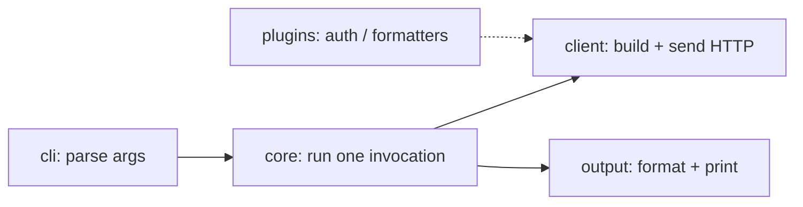

# KT protocol — level templates

Each level is one message: the content, at most one diagram, one check question, then
`next / deeper <x> / skip / stop`. Keep it ≤ ~25 lines. Tags: `[F]` tool fact, `[R]` read, `[I]` inference.

---

## L1 — What it is and how to run it

```
**<repo>** is <one line: what it does> for <who> [R README:line].
Kind: <application | library> [F entrypoints.repo_kind]. Main language: <lang>, ~<LOC> LOC [F manifest].
Run:  <command>   [R <build file>:line]
Test: <command>   [R <build file or CI workflow>:line]
Entry: <console script / main / public API> → <path:line> [F entrypoints]
```
Only list a command you found in a build file, CI config or README. Otherwise "not determined".
No check question at L1.

## L2 — The map

Group modules into 4–7 boxes by package, using `imports.json` and `centrality.json`. One line per box:
what it is responsible for, plus its anchor file. Draw the arrows that `imports.json` supports.


Name the boxes by **role**, not by folder name. A box you cannot describe from evidence becomes
"<pkg>: not determined yet" rather than a guess.

Check question: "Where would a bug in <visible symptom> most likely live?"

## L3 — The golden path

Start from `golden_path.json`: an outline of the main branch under the entrypoint, callees listed in
call-site order. **Open every hop** and verify it. Where the outline stops early or jumps to a side
branch (error handling, logging), read the last real hop and find the true next call: callbacks,
DI and method calls on objects are invisible to the static graph.

Worked example (httpie @ 5b604c3, from `examples/httpie/`):

```
1. `http` console script → httpie.__main__:main   [F entrypoints: setup.cfg]
2. __main__.main imports and calls core.main        [F calls] httpie/__main__.py:6
3. core.main → raw_main(..., main_program=program)  [R] httpie/core.py:146, :164
4. raw_main parses argv                             [R] httpie/core.py:77
5. raw_main calls main_program(...) — the callback  [R] httpie/core.py:100
   ↳ static graph stops here: `program` is passed as an argument, so no edge exists.
6. program() → collect_messages(env, args)          [R] httpie/core.py:170, :207
7. collect_messages builds the session and sends    [R] httpie/client.py:43, :114
```
Then one sequence diagram of steps 1–7. Say plainly which hops were `[R]`-bridged.

Check question: "If you add a flag that changes how the request is sent, which hops must know about it?"

## L4 — Core nouns

Take the top 3–6 of `abstractions.json` (classes referenced from the most other files). Drop name
collisions (e.g. a local `Path` counted against `pathlib.Path` uses) after reading. For each:

```
**Environment** [F] httpie/context.py:46 — referenced from 27 files.
What: <one line, from reading the class> [R]
Created by: <where> [R] · Lives for: <one invocation / process / request> [R/I]
Key members: <2–3> [R]
```
Optional class diagram of the relationships you verified.

Check question: "Which object would you pass to a new output formatter, and why?"

## L5 — How to change X (tailored to the human's goal)

Two or three recipes, each:
```
To <goal>: touch <file:line> (<why>), <file:line> (<why>); test in <test file> [F tests_map].
Watch out: <coupling or gotcha> [R/I]
```
A recipe is only `[R]` if you opened the files. Otherwise mark it `[I]` and say what to check.

## L6 — Landmines and why

From `hotspots.json` (churn × complexity), `complexity.json`, `risks.json`:
```
Hot + complex: httpie/core.py — 14 commits in window, max CCN 26; owners: <top_authors> [F]
Why it's weird: <from `git log --format=%s -n 15 -- <file>`> [R]
Markers: <TODO/HACK lines worth knowing> [F]
```
Only run `git log` on the 2–3 hottest files. Summarise the why; don't paste logs.

Check question: "Which file would you be most careful changing, and what would you run before merging?"

## L7 — First task

One small, real change that touches the golden path, plus how to verify it:
```
Task: <e.g. add a --verbose-timing flag that prints elapsed time per request>
Touch: <files> · Test: <command> · Done when: <observable result>
Revisit: <weak spots recorded in kt_state.md>
```

---

## kt_state.md format

```
goal: <what the human is here to do>
level: L3
knows: <stack familiarity, things already explained>
weak_spots: <check questions missed>
bridged_edges: <path:line -> path:line, how found>
open_questions: <...>
```
